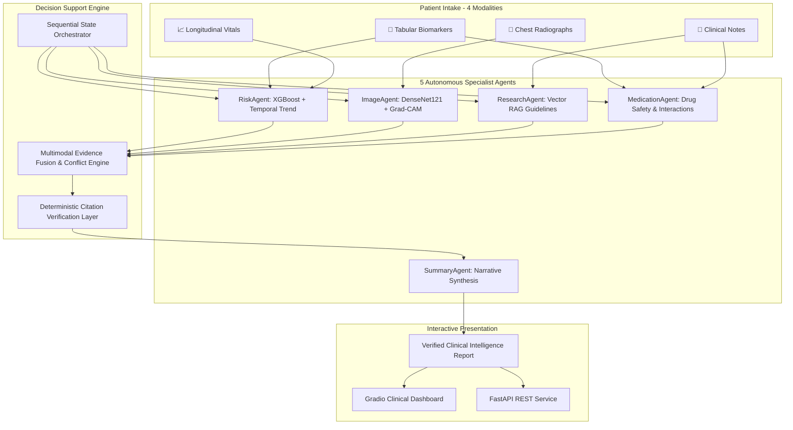

<div align="center">

# 🩺 MedNexus AI 2.0
### Autonomous Multimodal Clinical Intelligence & Decision Support System

[](https://www.python.org/)
[](https://fastapi.tiangolo.com/)
[](https://gradio.app/)
[-brightgreen?style=for-the-badge&logo=githubactions&logoColor=white)](run_tests.py)
[](docs/ARCHITECTURE.md)
[](docs/SAFETY.md)
[](LICENSE)

<p align="center">
  <b>A research-grade clinical intelligence framework fusing 4 heterogeneous modalities across 5 autonomous agents with grounded RAG, Grad-CAM imaging explainability, and deterministic claim verification.</b>
</p>

[Quickstart](#-quickstart-windows--cross-platform) • [Architecture](#-system-architecture) • [Dashboard Features](#-interactive-dashboard-tour) • [API Guide](#-fastapi-backend) • [Academic Presentation](#-presentation--viva-guide)

</div>

---

> ⚠️ **CLINICAL RESEARCH DEMO — 100% SYNTHETIC DATA**  
> This system is built strictly for software architecture demonstration, education, and research. It does **not** diagnose, treat, or replace professional clinical judgment. See [`docs/SAFETY.md`](docs/SAFETY.md).

---

## 🌟 Key Capabilities

- **🧬 4 Heterogeneous Modalities:** Seamlessly ingests structured laboratory biomarkers, 5-encounter longitudinal vitals, unstructured physician clinical notes, and digital chest radiography (CXR).
- **🤖 5 Autonomous Specialist Agents:** Decoupled multi-agent architecture where individual agents own their respective clinical modalities and emit auditable execution traces.
- **🔍 Dual-Layer Explainability:** Combines **SHAP / Permutation feature attributions** for tabular risk models with **Grad-CAM spatial activation heatmaps** for radiographic anomaly localization.
- **📚 Grounded RAG with Zero Hallucination:** Queries vetted medical guidelines (ACC/AHA, ADA, GOLD); claims are linked directly to evidence IDs.
- **🛡️ Deterministic Verification Layer:** Automated claim-level verification gate that blocks or flags ungrounded assertions prior to report generation.
- **⚖️ Cross-Modal Conflict Detection:** Identifies discordant signals (e.g. low tabular risk vs. abnormal lung opacity) and elevates them for clinician review rather than averaging them away.
- **🧪 100% Offline Capability:** Operates completely offline with local Ollama (`qwen3:4b`) or zero-dependency deterministic template fallback engines.

---

## 🏗️ System Architecture



---

## 🖥️ Interactive Dashboard Tour

The Web UI (`http://127.0.0.1:7860`) provides an expansive clinical workflow across 6 dedicated views:

| Tab | Focus & Clinical Value |
| :--- | :--- |
| **1. Overview** | Comprehensive patient profile card, 5-modality intake breakdown, 4-metric vital snapshot panel, complete condition risk table, and medication interaction warning cards. |
| **2. Risk & Explainability** | SHAP / Permutation feature attribution bar chart showing primary risk drivers + 3-panel longitudinal hemodynamic trajectories (HR, BP, SpO2). |
| **3. Imaging** | High-resolution synthetic CXR alongside Grad-CAM activation heatmap overlay with spatial anomaly localization. |
| **4. Evidence** | Grounded clinical literature citations (ACC/AHA, ADA, GOLD) with similarity scores and exact quoted guideline excerpts. |
| **5. Agent Trace** | Chronological multi-agent execution timeline detailing agent decisions, timestamps, and tool calls. |
| **6. Final Report** | Executive clinical narrative, structured risk matrices, conflict disclosures, and evidence verification stamp. |

---

## ⚡ Quickstart (Windows & Cross-Platform)

### Option 1: One-Click Windows Setup (Recommended)
1. Clone this repository:
   ```cmd
   git clone https://github.com/YOUR_USERNAME/mednexus-clinical-intelligence.git
   cd mednexus-clinical-intelligence
   ```
2. Double-click **`install.bat`**  
   *(Creates `.venv`, installs dependencies, and trains models on synthetic cohorts).*
3. Double-click **`launch.bat`**  
   *(Launches the dashboard at `http://127.0.0.1:7860`).*

---

### Option 2: Manual Terminal Setup (Windows, macOS, Linux)
```bash
# 1. Create and activate a virtual environment
python -m venv .venv
source .venv/bin/activate  # On Windows: .venv\Scripts\activate

# 2. Install dependencies
pip install --upgrade pip
pip install -r requirements.txt

# 3. Train models on synthetic dataset (creates local artifacts)
python scripts/train_all.py

# 4. Launch the Gradio Dashboard
python app.py
```

---

### Option 3: Local LLM Support (Optional)
MedNexus AI automatically discovers local Ollama instances for generated summaries:
1. Install [Ollama](https://ollama.com).
2. Pull the default clinical model:
   ```bash
   ollama pull qwen3:4b
   ```
*(If Ollama is not installed, the system automatically uses its deterministic template fallback engine with zero downtime).*

---

## 🧪 Verification & Test Suite

Run the full offline test suite (no external network needed):

```bash
python run_tests.py
# or double-click run_tests.bat
```

```text
  PASS test_agents_produce_sections
  PASS test_api
  PASS test_compare_models
  PASS test_explain_fallback
  PASS test_fusion_conflict
  PASS test_fusion_label_invariance
  PASS test_fusion_missing_labels
  PASS test_llm_template_fallback
  PASS test_medication_flags
  PASS test_nlp_extraction
  PASS test_orchestrator_end_to_end
  PASS test_rag_citations
  PASS test_synth_determinism
  PASS test_synth_modalities
  PASS test_synth_no_images_mode
  PASS test_tabular_roundtrip
  PASS test_temporal_fallback
  PASS test_verification_flags_missing_evidence
  PASS test_vision_fallback

19/19 tests passed (100% PASS RATE)
```

---

## 🚀 FastAPI Backend

Serve the full agentic pipeline over REST:

```bash
uvicorn api.server:app --port 8123
```

- **Health Check:** `GET http://127.0.0.1:8123/health`
- **Interactive OpenAPI Docs:** `http://127.0.0.1:8123/docs`
- **Analyze Patient:**
  ```bash
  curl -X POST http://127.0.0.1:8123/analyze \
    -H "Content-Type: application/json" \
    -d '{"patient_id": "SYN-SHOW-01"}'
  ```

---

## 📁 Repository Structure

```text
├── agents/             # 5 Specialist agents (Risk, Image, Research, Medication, Summary)
├── api/                # FastAPI backend server and schema models
├── data/               # Seeded synthetic patient cohort generator (4 modalities)
├── docs/               # Architecture, demo script, viva Q&A, safety, and dataset guides
│   ├── ARCHITECTURE.md # System engineering design & trade-offs
│   ├── DEMO.md         # 5-minute presentation script
│   ├── VIVA.md         # Expected academic viva questions & answers
│   ├── SAFETY.md       # Clinical governance & responsible AI boundaries
│   ├── EVALS.md        # Model evaluation results & ablation experiments
│   └── DATASETS.md     # Guide for swapping in real MIMIC-IV / NIH CheXpert data
├── explain/            # SHAP, permutation feature importance, Grad-CAM re-exports
├── fusion/             # Multimodal evidence fusion & cross-modal conflict logic
├── llm/                # Ollama client + deterministic template fallback
├── models/             # Tabular (XGB/RF/LogReg), temporal, and vision models
├── rag/                # Curated clinical guideline vector knowledge base
├── scripts/            # Showcase patient presets & batch training runners
├── tests/              # 19-test automated test suite
├── app.py              # Main Gradio clinical dashboard
├── config.py           # Project paths and configuration settings
└── run_tests.py        # Standalone test runner
```

---

## 🎓 Presentation & Viva Guide

For students and researchers presenting this project:
- **5-Minute Live Script:** Review [`docs/DEMO.md`](docs/DEMO.md) for a second-by-second presentation walkthrough.
- **Viva Defense Questions:** Review [`docs/VIVA.md`](docs/VIVA.md) for bullet-proof answers to questions regarding synthetic data, hallucination prevention, agentic design vs. monolithic models, and clinical governance.
- **Real-World Data Ingestion:** Review [`docs/DATASETS.md`](docs/DATASETS.md) on how to connect credentialed MIMIC-IV and NIH ChestX-ray14 datasets.

---

## 📄 License & Attribution

This project is released under the **MIT License**.  
*Designed for education, academic peer review, and software architecture evaluation.*
